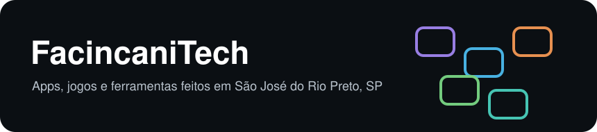
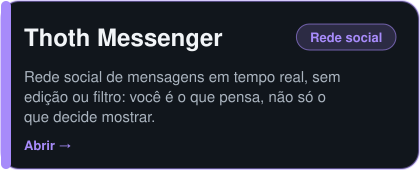
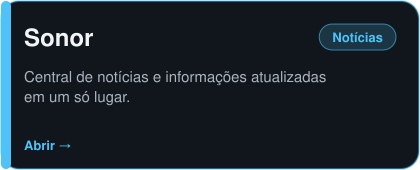
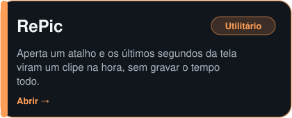
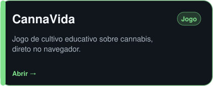
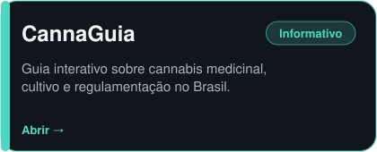

## Projetos

| Projeto | O que é | Tipo |
|---|---|---|
| [Thoth Messenger](https://facincanitech.github.io/thoth-site/) | Rede social de mensagens em tempo real, sem edição ou filtro: você é o que pensa, não só o que decide mostrar. | Rede social |
| [Sonor](https://facincanitech.github.io/Sonor/) | Central de notícias e informações atualizadas em um só lugar. | Notícias |
| [RePic](https://facincanitech.github.io/repic/) | Aperta um atalho e os últimos segundos da tela viram um clipe na hora, sem gravar o tempo todo. | Utilitário |
| [CannaVida](https://cannavida.pages.dev/) | Jogo de cultivo educativo sobre cannabis, direto no navegador. | Jogo |
| [CannaGuia](https://facincanitech.github.io/Cannaguia/) | Guia interativo sobre cannabis medicinal, cultivo e regulamentação no Brasil. | Informativo |
